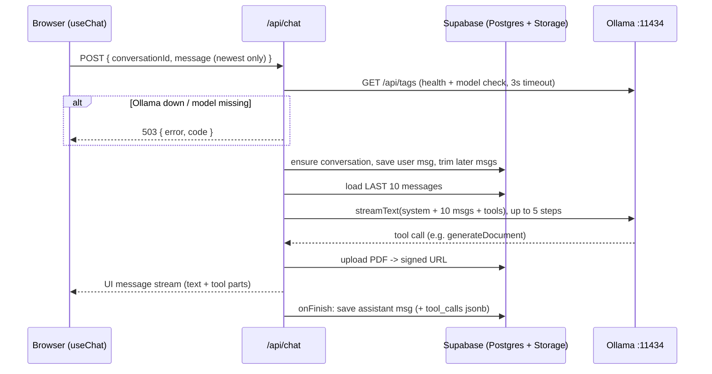

# Mini Agent: Local AI Assistant (Next.js + AI SDK + Ollama + Supabase)

A small agent that streams responses from a local Ollama model, keeps chat history in Supabase, and calls tools on its own: **calculator**, **getSystemTime**, and **generateDocument** (makes a PDF, uploads it to Supabase Storage, and returns a signed download URL).

## Architecture



| Path | Purpose |
| --- | --- |
| `supabase/schema.sql` | Tables, indexes, RLS policies, storage bucket |
| `app/api/chat/route.ts` | `streamText` + tools + persistence + error handling |
| `lib/tools.ts` | The 3 tools (AI SDK `tool()` with zod schemas) |
| `lib/ollama.ts` | Provider config, health check, error translation |
| `lib/prompt.ts` | System prompt that tells the model when to use each tool |
| `lib/persistence.ts` | UIMessage ⇄ DB row mapping, 10-message window |
| `lib/calculator.ts` | Safe math parser (no `eval`) |
| `lib/pdf.ts` | Text → PDF with `pdf-lib` (wrapping, pagination, headings) |
| `components/*` | Chat UI, sidebar, tool status cards, Ollama status pill |

## Setup

1. **AI Provider (EVREN AI or Ollama).**
   - **EVREN AI (Recommended for 120B+ cloud models):** Set `AI_PROVIDER=evren`, `EVREN_BASE_URL=https://evren-llmapi.ssyz.org.tr/v1`, `EVREN_API_KEY=evren_llm_...`, and `EVREN_MODEL=auto` (or any model from `GET /v1/models`) in `.env.local`. Ensure EVREN API terms are accepted via `POST /v1/terms/accept`.
   - **Ollama (Local fallback):** Pull a model that **supports tool calling**:
   ```bash
   ollama pull qwen2.5:7b    # or llama3.1, llama3.2, phi4-mini
   ollama serve
   ```
   > The original `llama3` and `phi3` models do **not** support tools in Ollama. Requests fail with "does not support tools", and the app shows that error in plain words.

2. **Supabase.** Open the SQL editor and run `supabase/schema.sql`. It creates the tables and the private `documents` bucket.

3. **Env.** Copy `.env.example` to `.env.local` and fill in `SUPABASE_URL` and `SUPABASE_SERVICE_ROLE_KEY`.

4. **Run:**
   ```bash
   npm install
   npm run dev      # http://localhost:3000
   ```

## Design notes

- **Provider package.** There is no official `@ai-sdk/ollama` package on npm. This project uses `ollama-ai-provider-v2`, the community provider listed in the AI SDK docs. It is set up in `lib/ollama.ts` with `baseURL: http://localhost:11434/api`.
- **Context window.** The client sends only the newest message. The server loads the **last 10** messages from Supabase (`env.contextWindowMessages`). Stored tool calls and results are rebuilt into proper multi-step model messages.
- **Error handling.** If Ollama is unreachable, a pre-flight health check returns `503` before any streaming starts. Mid-stream failures (connection drop, OOM, model without tool support) go through `describeOllamaError` and appear in the UI with a **Retry** button. When you press **Stop**, the server request is aborted, which frees the GPU.
- **Security.** The service-role key is used only in server code (`server-only`). RLS is enabled with ownership policies, so the anon key cannot read the tables. Users are identified by an anonymous httpOnly cookie UUID. For real accounts, replace `lib/user.ts` with Supabase Auth.
- **PDFs.** The bucket is private and links are 7-day signed URLs. Deleting a conversation also deletes its PDFs.
